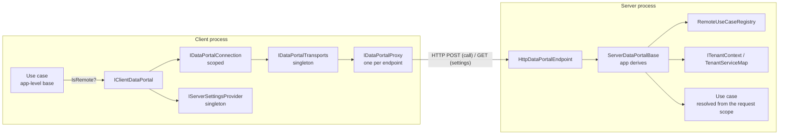
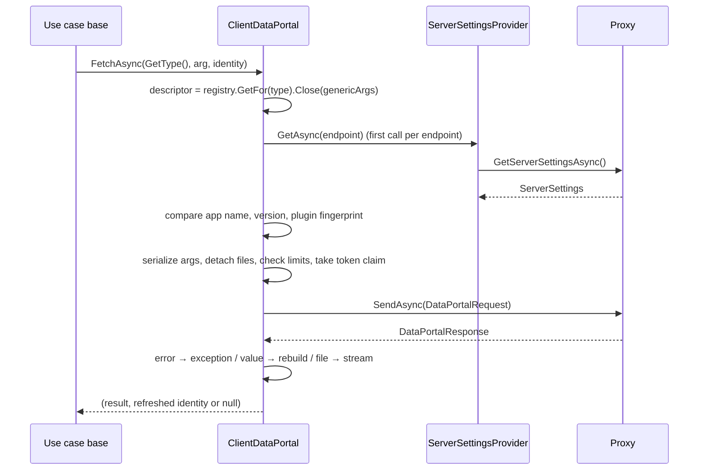

# 1. Data portal mechanics

The data portal is one abstraction over "run this use case here" and "run it on a server". A use case is
written once; whether a call runs in process or travels to a server is decided per DI scope, by the endpoint the
scope is connected to.

This document explains how that works, from the contract a use case declares to the bytes on the wire.

**Contents**

1. [Components](#1-components)
2. [Deployments and build configurations](#2-deployments-and-build-configurations)
3. [Connections: endpoints, transports, proxies](#3-connections-endpoints-transports-proxies)
4. [The contract: remote services and the registry](#4-the-contract-remote-services-and-the-registry)
5. [What crosses the wire](#5-what-crosses-the-wire)
6. [A call on the client](#6-a-call-on-the-client)
7. [A call on the server](#7-a-call-on-the-server)
8. [Errors](#8-errors)
9. [Identity and security](#9-identity-and-security)
10. [Versions, protocol and plugins: compatibility checks](#10-versions-protocol-and-plugins-compatibility-checks)
11. [Tenancy at call time](#11-tenancy-at-call-time)
12. [The HTTP transport on the wire](#12-the-http-transport-on-the-wire)
13. [Lifetimes, caching and threading](#13-lifetimes-caching-and-threading)
14. [Known limitations](#14-known-limitations)

---

## 1. Components



| Component | Side | Lifetime | Role |
|---|---|---|---|
| `IClientDataPortal` | client | scoped | What a use case base talks to: `IsRemote`, `FetchAsync`, `InvokeAsync`. |
| `IDataPortalConnection` | client | scoped | The endpoint of the scope, set once; gives the proxy. |
| `IDataPortalTransports` | client | singleton | Transports by name; one proxy per endpoint, cached for the life of the app. |
| `IDataPortalTransport` | client | singleton, many | A kind of connection: `local`, `http`, or the app's own. |
| `IDataPortalProxy` | client | per endpoint | Sends the canonical request over its transport and returns the canonical response. |
| `IServerSettingsProvider` | client | singleton | Fetches and caches each server's `ServerSettings`. |
| `RemoteUseCaseRegistry` | both | singleton | The only place a name from the wire becomes a type. |
| `ServerDataPortalBase` | server | app's choice | The server pipeline; the app supplies token verification and authorization. |
| HTTP endpoint | server | static | Translates HTTP into `DataPortalCall` + `IDataPortalRequestBody`, and the response back. |
| `IRemoteErrorMapper` | both | singleton | App exceptions ⇄ `RemoteError`. |
| `IAppVersionProvider` | both | singleton | The app's name and version, compared before the first call. |

The client and the server speak a **canonical, transport-independent form**: `DataPortalCall` (the description of
a call), `DataPortalRequest` (call + JSON payload + files), `DataPortalResponse` (none / value / file / error, plus an
optional refreshed identity). A transport only translates this form; it knows nothing about use cases.

---

## 2. Deployments and build configurations

Every app build is one of four deployments, passed to the IoC manager as a `BuildConfiguration`:

| Build | Meaning | Local endpoint implied? |
|---|---|---|
| `Server` | A server, reached through the data portal only. | yes |
| `Client \| Server` | An ASP.NET server that also serves a web UI. The UI runs use cases in process; the data portal serves remote clients. | yes |
| `Client` | A thin client (Blazor WebAssembly): always remote. | no |
| `Client \| Local` | A thick client (WinForms/WPF): remote or local. | yes |

`BuildConfiguration` is a flags enum: `Client = 1`, `Server = 2`, `Local = 4`, `Backend = Server | Local`,
`Any = Client | Server | Local`. Every implementation declares the roles it serves (in
`[DefaultServiceImplementation(..., forBuildConfiguration)]`, in a configuration class, in an external service or an
unmanaged library descriptor). **An implementation is registered in a build if the two share a role**
(`(implementation & build) != 0`, `BuildConfigurationExtensions.Serves`).

What this means for the data portal:

| Component | Declared for | Registered in |
|---|---|---|
| `IClientDataPortal`, connection, transports registry, settings provider | `Any` | every build (lookups and use case bases need `IsRemote` everywhere) |
| local transport | `Backend` | `Server`, `Client \| Server`, `Client \| Local` |
| HTTP transport | `Client` | `Client`, `Client \| Server`, `Client \| Local` |
| `HttpDataPortalClientOptions` | `Client` | client builds |
| `HttpDataPortalServerOptions` | `Server` | server builds |

So a thin client can only call remotely, a server only locally, and the other two can do both. See
[02 §3](02-ioc-manager.md#3-choosing-the-build-configuration-of-an-implementation) for how to mark the app's own
implementations.

---

## 3. Connections: endpoints, transports, proxies

### 3.1 Endpoint

`DataPortalEndpoint(string transport, Uri address = null)` is immutable and compared by value (transport name
ignoring case, address exactly). Two names are built in: `DataPortalEndpoint.Local` (`"local"`, no address) and
`DataPortalEndpoint.Http` (`"http"`, an absolute URL of the server's data portal route).

### 3.2 Transports and proxies

An `IDataPortalTransport` has a unique `Name`, says whether it `RequiresAddress`, and `CreateProxy(endpoint)`.
`IDataPortalTransports` (singleton) collects every registered transport (framework, app and plugins: the interface
allows multiple implementations), refuses duplicate names at construction, checks an endpoint's transport name and
address, and **creates one proxy per endpoint, kept for the life of the app**. A proxy is therefore shared by all
users and scopes and must hold no per-user state.

| Proxy | `IsRemote` | Notes |
|---|---|---|
| local | `false` | Never sends anything: `SendAsync` and `GetServerSettingsAsync` throw. Use cases run in process. |
| HTTP | `true` | One static `HttpClient` for all endpoints (infinite client timeout; per-call `CallTimeout`). |

### 3.3 The scope's connection

`IDataPortalConnection` is **scoped and set once**:

1. If the app calls `Initialize(endpoint)` before anything reads the connection, that endpoint is used. `Initialize`
   validates the endpoint immediately (unknown transport, missing or unexpected address → `ArgumentException`).
2. Otherwise the configured endpoint (`DataPortalConnectionConfiguration`: `Transport`, `Address`) is used.
3. Otherwise, in a build that includes the backend (`Server`, `Client | Server`, `Client | Local`), the local
   endpoint is implied.
4. Otherwise (`Client` without configuration) reading `Endpoint`, `Proxy` or `IsRemote` throws
   `InvalidOperationException("No data portal endpoint is set for this scope, and none is configured.")`.

Reading the endpoint fixes it: `Initialize` after the first read throws. **Changing server means a new scope**
(log out, choose another, log in): an identity belongs to one server.

`IClientDataPortal.IsRemote` is `IDataPortalConnection.IsRemote`, i.e. the proxy's.

---

## 4. The contract: remote services and the registry

### 4.1 Declaring a remote service

```csharp
[UseCase(ServiceLifetime.Transient)]            // or [RemoteService]; both are [Service]
public interface IGreetUseCase
{
    [RemoteMethod]
    Task<Greeting> ExecuteAsync(string name);
}
```

Rules, checked when the use case is first described (and in depth by `DataPortalConventions`):

- exactly **one** `[RemoteMethod]` across the interface and the interfaces it extends;
- it returns `Task` or `Task<T>`;
- the interface is closed (no open generic interface); the *method* may be generic (lookup services are);
- parameters are values that can cross (see §5); no `ref`/`out`, pointers or `Stream`.

`[RemoteService]` is inherited by derived interfaces; `[TenantScoped]` is not.

### 4.2 The registry

`IoCManagerBase.Initialize` scans the framework's, the app's and the accepted plugins' assemblies once and builds
the `RemoteUseCaseRegistry` (singleton):

- **Use cases** by wire name: every remote service interface **that has an implementation** marked
  `[DefaultServiceImplementation]` in a scanned assembly (an interface with no implementation cannot be invoked, so
  it is not registered). The implementation's build configuration does not matter for the registry.
- **Trusted wire types** by wire name: every remote service implementation, every concrete domain object
  (`DomainObject<T>`, entities included), every lookup type (`LookupBase<T>`) and its entity type.
- Two *different* types with one wire name stop startup ("cannot tell them apart"); the same type found twice is
  fine.

Wire name = `Type.ToString()`: no assembly name or version, so client and server builds of the same app match.

Descriptors (`RemoteUseCaseDescriptor`: the method, a `RemoteValueDescriptor` per parameter and for the result) are
built **lazily on the first call** and cached; a use case that cannot be described fails on every call with the
reason (the failure is cached too). This keeps startup fast for apps with 10–20k use cases; it also means a broken
contract is only found when called, or by the convention test ([03 §3.4](03-app-data-portal-components.md#34-the-convention-test)).

### 4.3 Generic remote methods

A generic remote method (e.g. a lookup service's `FetchAsync<TLookup, TEntity>(Type requester)`) is registered open
and closed per call. The generic arguments travel **by wire name** and are resolved on the server **only through
the trusted wire types**; the client checks the same rule before sending. Arguments that violate the method's
constraints are refused.

---

## 5. What crosses the wire

Everything is JSON (Newtonsoft.Json) with fixed settings (`DataPortalSerialization`), identical on both sides:

| Setting | Value | Why |
|---|---|---|
| `TypeNameHandling` | `None` | A payload must never choose the type it is read into. |
| `MetadataPropertyHandling` | `Ignore` | `$type`, `$ref`, `$id` are ordinary unknown properties. |
| `MaxDepth` | server's `MaxDepth` (default 32) for values; 32 for portal messages | Deep JSON overflows the stack, which cannot be caught. |
| `FloatParseHandling` | `Decimal` | No silent precision loss. |
| `DateParseHandling` | `DateTime` | |
| Contract resolver | `DataPortalContractResolver` | Serialization constructors, safe dictionary keys, query result subtotals. |
| Converters | files, `Type` values | See below. |

How each declared type crosses (decided from the **method signature only**, the same on both sides):

| Declared type | On the wire | On arrival |
|---|---|---|
| Domain object (`IDtoSerializable<TDto>`) as a top-level parameter or result | its DTO (`ToDto()`) | rebuilt with `ToEntity(context)` using the receiving side's `Domain.IApplicationContext` |
| `FileContent` parameter, or anywhere inside a parameter (in a DTO, a list) | `{"fileRef": n}` in the JSON, content as multipart part *n* | the server spools it to a temp file and reattaches it |
| `FileContent` result | a streamed download | the caller must dispose it |
| `FileContent` nested in a result | `null` | files travel upstream only |
| `Type` value | its wire name, only if a trusted wire type | resolved through the trusted wire types |
| anything else (POCO, query result, lookup, list, primitive) | plain JSON | read-only types via their `[SerializationConstructor]` |

Rules (enforced at run time where noted, all checked by `DataPortalConventions`):

- **Domain objects only at the top level.** A domain object nested in a POCO, DTO or list is refused by the
  conventions; it would serialize as a live object.
- **No untyped members**: `object`, `JToken`, non-generic collections.
- **No abstract classes or interfaces** except the collection interfaces Json.NET can create (`IEnumerable<T>`,
  `IList<T>`, `IReadOnlyList<T>`, `IReadOnlyDictionary<K,V>`, ...).
- **Constructors.** A lookup or a query result needs a `[SerializationConstructor]`; any other class needs one, or a
  public parameterless constructor, or a single public constructor. A serialization constructor **must be private**
  (run time: `InvalidOperationException` on first use) and every parameter must match a serialized property of the
  same name (ignoring case) **and the same type** (run time: refused when the type is first used, instead of the
  parameter silently getting its default).
- **Dictionary keys**: string, enum, primitive, `Guid`, `DateTime`, `DateTimeOffset`, `TimeSpan`, `decimal`
  (nullable included). Enforced at run time by the contract resolver, because Json.NET never passes keys through
  converters (a `Type` key would be resolved with `Type.GetType`).
- **Query results** (`QueryResultBase`) get `CalculateSubtotals()` after deserialization: derived columns are never
  sent.
- **Untrusted file metadata.** File names and content types are sanitized on arrival (server: uploads; client:
  downloads) by `Sanitizer`: only the last path segment, no control/invisible characters, Windows-invalid characters
  replaced, ≤ 255 UTF-8 bytes. The use case still decides where (and whether) to store a file.

---

## 6. A call on the client

`FetchAsync`/`InvokeAsync(useCaseType, args..., identity)`; `useCaseType` may be the interface or the
implementation (`this.GetType()` in a base class): the registry finds the single remote interface it implements.



Step by step:

1. **Describe.** The registry gives the descriptor; a generic method is closed over the generic arguments (each
   must be a trusted wire type). `FetchAsync<TResult>` checks that the remote method returns `TResult`.
2. **Server settings.** Fetched once per endpoint and cached (one fetch shared by concurrent callers; a failed
   fetch is not cached). The client then compares:
   - application name: must be equal (ordinal);
   - version, by `DataPortalClientOptions.AppVersionMatch`: `Exact`, `MajorMinor` (default), `None`; a missing
     build/revision counts as 0;
   - plugin fingerprint: must be equal.

   A mismatch fails the call **without sending it**, as `RemoteErrorKind.VersionMismatch` with a
   `VersionMismatchData` in `RemoteError.Data`, and forgets the cached settings (the server may be updated again).
3. **Request.** Arguments are written as a JSON array in signature order; every `FileContent` is detached and
   replaced by a reference. The client checks the server's limits **before sending**: payload length, file count,
   per-file and total length of files whose length is known (seekable). A file of unknown length is counted while it
   is sent and the send is stopped at the limit.
4. **Token.** With an identity, the token is the value of its `TokenClaimType` claim (default `carma:token`); an
   identity without it throws `InvalidOperationException`. A `null` identity makes an anonymous call.
5. **Call description** (`DataPortalCall`): use case wire name, parameter wire type names, token, `CurrentCulture`
   and `CurrentUICulture` names, file count, generic argument names, plugin fingerprint.
6. **Send** through the scope's proxy. The caller keeps owning the uploaded files (each stream is read once, never
   disposed by the portal).
7. **Response**:
   - error → `IRemoteErrorMapper.ToException(error)` or `RemoteCallException`; a `BadRequest` invalidates the cached
     settings (most likely the server was updated);
   - none → `null` (refused if the result type cannot be null);
   - file → a `FileContent` streaming the rest of the body; **dispose it** to release the connection;
   - value → checked against the expected wire type name, deserialized, a domain object rebuilt with the client's
     `Domain.IApplicationContext`. Anything unexpected is reported as `BadRequest` (version skew).
8. **Identity.** A refreshed identity, if the server sent one, is returned beside the result. The caller (the use
   case base) must replace its identity with it.

`InvokeAsync` discards the result (a downloaded file is released unread).

There is **no cancellation token** on `IClientDataPortal`; cancellation and timeouts are the transport's
(`HttpDataPortalClientOptions.CallTimeout`).

---

## 7. A call on the server

`ServerDataPortalBase.HandleAsync(call, body, requestServices, cancellationToken)` never throws: every failure
becomes an error response. The call is cleared **from its description first**, and only then is its data read:

| # | Step | Refused as |
|---|---|---|
| 1 | Apply the caller's culture and UI culture (names ≤ 32 chars, unknown ignored), so even refusals are localized | — |
| 2 | Plugin fingerprint equals the server's | `VersionMismatch` |
| 3 | Token present → `VerifyIdentityAsync(token, services)` (app) → identity; `null` | `Unauthorized` |
| 4 | Use case name found in the registry (never resolved by type name) | `BadRequest` ("unknown") |
| 5 | Generic arguments resolved through trusted wire types | `BadRequest` |
| 6 | Tenant: `GetTenantId(identity)`, `GetTenantPlugins(identity)` (app); plugins must be installed; `ITenantContext.Initialize` | `Unauthorized` ("enter the tenant again") |
| 7 | Use case available for the tenant (`TenantServiceMap.IsAvailable`) | `Unauthorized` ("requires a tenant account") for an app use case without tenant; otherwise `BadRequest` "unknown" |
| 8 | Resolve the use case and `Domain.IApplicationContext` from the request scope | server error if not registered |
| 9 | `AuthorizeAsync(useCase, descriptor, identity, services)` (app) | whatever the mapper maps the exception to |
| 10 | Parameter count and wire type names equal the signature; file count ≤ `MaxFileCount` | `BadRequest` |
| 11 | Read the payload (≤ `MaxPayloadLength`) | `BadRequest` |
| 12 | Spool each declared file to a temp file, enforcing `MaxFileLength` and `MaxUploadLength` while reading; no extra file allowed | `BadRequest` |
| 13 | Deserialize the parameters (depth ≤ `MaxDepth`), rebuild domain objects with the request scope's context, reattach files; every file must be referenced | `BadRequest` |
| 14 | Invoke the remote method; exceptions thrown before the first `await` are unwrapped | mapper |
| 15 | `GetRefreshedIdentityAsync(identity, services)` (app; default `null`) | — |
| 16 | Build the response: none / value (serialized here, so a serialization failure is still an error response) / file | — |

Notes:

- **Uploaded files** reach the use case only once all have arrived and passed the checks, as seekable
  `FileContent` streams of known length, spooled to `SpoolDirectory` (default: system temp) with
  `FileOptions.DeleteOnClose`. They are deleted when the response is disposed: **a use case that keeps a file must
  copy it during the call.**
- **Responses own resources** (spooled files, the result's memory stream); the endpoint disposes the response after
  sending it.
- The use case and the domain context are resolved **from the request's scope** (`services`), so scoped services
  (the validation provider, the tenant context, the authentication state) are per call.
- `RefusedBeforeBody` tells the endpoint whether the body was touched; the HTTP endpoint uses it for
  `Expect: 100-continue` (§12).

---

## 8. Errors

Exceptions never cross the data portal; a `RemoteError { Kind, Message, CorrelationId, Data }` does.

| `RemoteErrorKind` | Produced by | Message/data sent | Logged on server |
|---|---|---|---|
| `ServerError` | unmapped exception (mapper returns `null`), or mapper says so | stripped; correlation id only | yes, with correlation id |
| `Business` | mapper | as mapped (localized for the caller's culture) | no (the use case's business) |
| `Validation` | mapper | as mapped, e.g. broken rules in `Data` | no |
| `Concurrency` | mapper | as mapped | no |
| `Unauthorized` | invalid token, tenant plugins changed, tenant required, or mapper | as mapped | yes, with correlation id |
| `ServiceUnavailable` | mapper (e.g. transient failure after retries); client: server unreachable, timeout, 408/502/503/504 | as mapped | yes |
| `BadRequest` | pipeline refusals (malformed call, limits, unknown use case); client: unreadable response, limits exceeded before sending | stripped; correlation id only | yes |
| `VersionMismatch` | plugin fingerprint differs (server); app name/version/plugins/protocol differ (client, before sending) | `VersionMismatchData` (client side) | yes (server side) |

On the client every error becomes `IRemoteErrorMapper.ToException(error)` or, if that returns `null`, a
`RemoteCallException` (with `Kind` and `Error`). Transport failures (`DataPortalTransportException` from a proxy) go
the same way, with the transport exception as the inner exception.

`RemoteCallRejectedException` is internal plumbing (its message is for the log only, never sent).

---

## 9. Identity and security

- **The client's identity is a claim, not a fact.** Only the token travels (HTTP: `Authorization: Carma <token>`);
  the server derives the identity from it in `VerifyIdentityAsync`. The token must be printable ASCII without
  spaces (JWTs are); otherwise the HTTP proxy refuses to send it.
- **The settings GET is anonymous** by design: a client needs the settings before it can log in, and logging in is a
  call. They contain only the app name and version, the limits and the plugin fingerprint.
- **Anonymous calls** (null identity) reach `AuthorizeAsync` with `identity == null`; the app must refuse them
  except for the use cases meant for it (login, registration...).
- **Authorization happens before any data is read**, from the use case object and its descriptor only.
- **Refreshed identity**: returned in the response body, not in a header (a full identity can exceed proxy header
  limits; `MaxIdentityLength`, default 1 MB, on the client).
- **Tenancy is taken from the verified identity only** (claims the server itself put there), never from data the
  client sends separately.
- **Names from the wire never load types**: use cases are looked up in the registry; generic arguments and `Type`
  values only through the trusted wire types; JSON cannot name types.
- **Limits are enforced on both sides**: the client to avoid sending what will be refused, the server because the
  client is untrusted. The HTTP endpoint also raises the host's body size limit to exactly what the options allow.

---

## 10. Versions, protocol and plugins: compatibility checks

Three independent checks keep a client from talking to a server it would misunderstand:

| Check | Where | Failure |
|---|---|---|
| **Protocol version** (`X-Carma-Protocol`, currently `"2"`) | every request (server refuses another version as `BadRequest`); settings GET response (client compares) | client: `VersionMismatch` ("speaks data portal protocol ...") |
| **App name and version** (`IAppVersionProvider`, `AppVersionMatch`) | client, against the cached settings, before the first call | `VersionMismatch` |
| **Plugin fingerprint** (ids + versions of the installed plugins) | client before the first call; server on every call | `VersionMismatch` |

The cached settings of an endpoint are forgotten after a `BadRequest` or a `VersionMismatch`, so the next call
fetches them again (a server updated in the meantime is detected).

Deployment guidance:

- With `MajorMinor` (default), ship server-only hotfixes as build/revision increments; a major or minor bump forces
  every client to update.
- Ship framework updates with an app version bump: the framework's own types appear on the wire (generic argument
  names, `Type` values), and nothing else compares framework versions.
- Plugins must be identical (ids and assembly versions) on client and server.

---

## 11. Tenancy at call time

In a tenant-based app, the tenant of a call and the plugins assigned to it come from the verified identity:

1. The server derives them with `GetTenantId(identity)` and `GetTenantPlugins(identity)` (default: no tenant).
2. If an identity names a plugin that is not installed (removed since the identity was issued), the call is refused
   as `Unauthorized` ("enter the tenant again").
3. `ITenantContext.Initialize(tenantId, plugins)` is called on the request scope **before** anything tenant scoped is
   resolved; it can be called only once per scope.
4. A tenant scoped use case unavailable for the tenant is answered exactly like an unknown use case (so nothing
   reveals another tenant's plugins), except an app use case called without a tenant: "requires a tenant account".
5. Resolving a tenant scoped interface goes through a factory that picks the implementation of the tenant's plugin,
   or the app's default.

The client mirrors this: each client scope initializes its `ITenantContext` from the identity it received; changing
tenant means a new scope. Details: [02 §10](02-ioc-manager.md#10-tenancy).

---

## 12. The HTTP transport on the wire

### 12.1 Settings: `GET <endpoint>`

No custom header (no CORS preflight). Answer: `200`, `X-Carma-Protocol: 2`, `Cache-Control: no-store`, JSON of
`ServerSettings` (≤ 64 KB on the client).

### 12.2 Call: `POST <endpoint>`

Request headers (every value ASCII; free text percent-encoded UTF-8; lists percent-encoded and comma-joined):

| Header | Content |
|---|---|
| `X-Carma-Protocol` | `2` |
| `X-Carma-Use-Case` | use case wire name |
| `X-Carma-Parameter-Types` | parameter wire type names |
| `X-Carma-Generic-Arguments` | generic argument wire names (generic methods only) |
| `X-Carma-Plugins` | client plugin fingerprint |
| `X-Carma-Culture`, `X-Carma-UI-Culture` | culture names |
| `X-Carma-File-Count` | number of file parts |
| `Authorization` | `Carma <token>` (absent for anonymous calls) |
| `Expect` | `100-continue` when files are sent (not in a browser) |

Body: `multipart/form-data` (boundary `carma-<guid>`): part `payload` (`application/json; charset=utf-8`, the
arguments array) first, then parts `file-0`, `file-1`, ... with file name (`filename` and RFC 5987 `filename*`),
content type and, when known, length.

The client checks header lengths before sending (`MaxRequestHeaderLength`, default 8 KB per header;
`MaxRequestHeadersLength`, default 16 KB total) because reverse proxies refuse oversized headers with a bare 400/431.

### 12.3 Response

Every portal outcome is **HTTP 200** with `X-Carma-Result`:

| `X-Carma-Result` | Body | Other headers |
|---|---|---|
| `error` | JSON `RemoteError` | — |
| `none` | identity block only (if any) | `X-Carma-Identity-Length` |
| `value` | identity block, then the result JSON | `X-Carma-Result-Type`, `X-Carma-Identity-Length` |
| `file` | identity block, then the file content (streamed) | `X-Carma-File-Name`, `X-Carma-File-Content-Type`, `X-Carma-File-Length` (if known), `X-Carma-Identity-Length` |

The one exception: a call with `Expect: 100-continue` refused **before its body was read** is answered
**417 Expectation Failed** (with `X-Carma-Result: error`), so the files are never sent. A 417 *without* the result
header comes from an intermediary that does not support the expectation; the client then resends without it (safe:
no file was read yet). Any other status, or a 200 without the result header, comes from the infrastructure
(gateway, proxy, login page) and is reported as `ServiceUnavailable` (408/502/503/504) or `ServerError`.

A call refused while its body is arriving is answered only after the rest of the body has been read and discarded:
an HTTP/1.1 client still sending would otherwise see a broken connection instead of the error.

### 12.4 Timing details

- On .NET the body is sent anyway if the server has not answered the expectation within the handler's
  `Expect100ContinueTimeout` (1 s by default; set a longer one in `CreateHttpMessageHandler`). If token verification
  takes longer, a refused call will already have sent part of its files; the result is the same.
- `CallTimeout` (default 100 s) limits a call until the response headers arrive, the upload included; a download is
  read afterwards without that limit.
- A download that fails mid-stream cannot be reported as an error (headers are sent): the client gets an
  `IOException` while reading the file.

### 12.5 Browsers (Blazor WebAssembly)

- `Expect` is a forbidden header: a refused call always transfers its files first.
- Response streaming is enabled on every request; request streaming is opt-in (`BrowserRequestStreaming`, requires
  .NET 7+ in the browser, a Chromium browser and HTTP/2).
- A cross-origin server needs CORS that allows `DataPortalHeaders.RequestHeaders` + `Authorization` and exposes
  `DataPortalHeaders.ResponseHeaders` ([04 §6](04-aspnetcore-endpoint.md#6-cors-for-browser-clients)). Without the
  exposed headers every call looks like an infrastructure failure.
- The HTTP message handler cannot be replaced in a browser.

---

## 13. Lifetimes, caching and threading

| Object | Lifetime | Thread safety / caching |
|---|---|---|
| `RemoteUseCaseRegistry`, descriptors | singleton; descriptors lazy, cached forever (failures too) | thread safe |
| `IDataPortalTransports` and its proxies | singleton; one proxy per endpoint forever | thread safe; proxies stateless |
| `HttpClient` | static, one per process | handler set once, before the first call |
| `IServerSettingsProvider` | singleton; settings per endpoint until invalidated | thread safe; one fetch shared |
| `IClientDataPortal`, `IDataPortalConnection`, `ITenantContext` | scoped | one logical flow per scope |
| `ServerDataPortalBase` | app's choice (singleton is fine; see 03 §9) | per-call state is local |
| `PluginCatalog`, `TenantServiceMap` | singleton, immutable | thread safe |

Assembly scans are cached per assembly in a `ConditionalWeakTable` (several IoC managers in one process, e.g. tests,
scan once).

---

## 14. Known limitations

- **No cancellation token** on `IClientDataPortal` calls.
- **One remote method per remote service**; a service implementation can have only one remote interface.
- **Files travel upstream only** inside values; a downloaded file must be the whole result.
- **Domain objects cross only at the top level** of a parameter or result.
- **Download failures mid-stream** surface as `IOException` while reading, not as a `RemoteError`.
- **Blazor WebAssembly and plugins**: a browser client has no plugins folder to enumerate, so its fingerprint is the
  "no plugins" one; against a server with plugins it fails the fingerprint check.
- **Framework version is not checked separately**: bump the app version when the framework changes.
- **Settings are public**: never put secrets into anything the settings carry (they carry only fixed framework
  values).
